<!-- Banner Animado Preto & Vermelho -->

  

<!-- Texto Digitando -->

  

<!-- Badges -->

  
  

---

### 👨‍💻 Sobre Mim

Sou instrutor e desenvolvedor focado em **Automação Industrial, Sistemas Embarcados (IoT)** e **Aplicações Web**. Atuo formando novos talentos no Programa **Trilhas de Futuro (MG)** e desenvolvendo sistemas que integram hardware, redes e software.

- 🔭 **Projeto em destaque:** **EnergizAR** — sistema supervisório industrial em **ESP32** com servidor web assíncrono, intertravamentos de segurança, atualização OTA sem cabo e IA local adaptativa.
- ⚙️ **Foco técnico:** Firmware resiliente em C/C++, interfaces IHM/SCADA e automação em Python.
- 👨‍🏫 **Mentoria:** Projetos integradores unindo eletrônica, IoT e desenvolvimento web.

---

### 🛠️ Tecnologias e Ferramentas

  

  
  
  
  

---

### 📊 Estatísticas no GitHub

  
  

  

---

### 🕹️ Pac-Man nas Contribuições

  <picture>
    <source media="(prefers-color-scheme: dark)" srcset="https://raw.githubusercontent.com/LenonYuri96/LenonYuri96/output/pacman-contribution-graph-dark.svg" />
    <source media="(prefers-color-scheme: light)" srcset="https://raw.githubusercontent.com/LenonYuri96/LenonYuri96/output/pacman-contribution-graph.svg" />
    
  </picture>

<!-- Rodapé Preto & Vermelho -->

  

